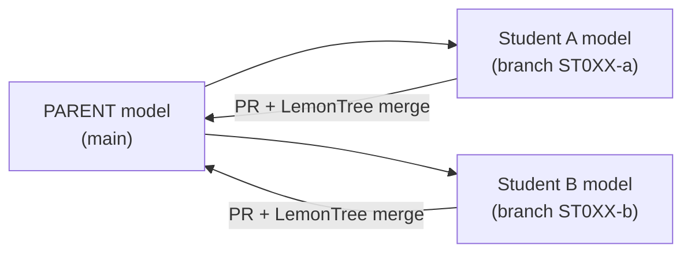
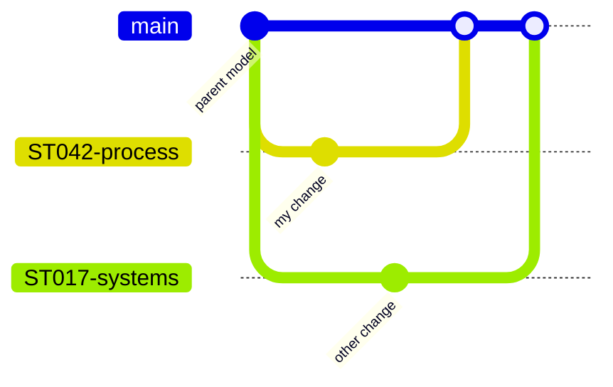
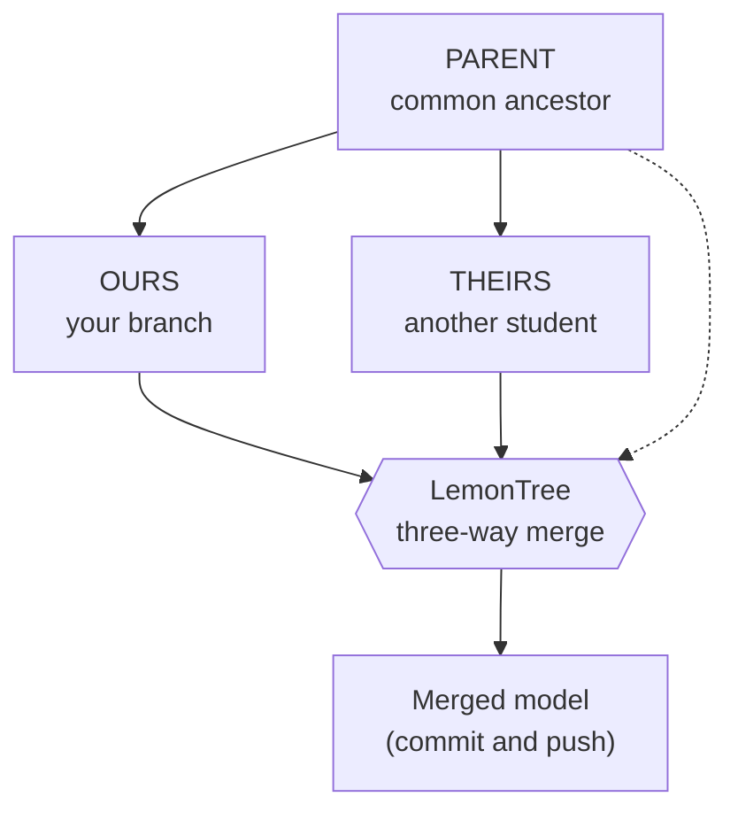

# EA model – STHDF 2026-2027 (decentralized modeling)

🇬🇧 **English** · [🇸🇰 Slovensky](#-slovensky)

## 🇬🇧 English

A minimal **parent model** in Enterprise Architect (`.qea`) for teaching decentralized
modeling with Git and LemonTree. It is **not** the faculty model — it exists to practice the
principles: **clone → own branch → change → pull request → merge**.

### The idea



The **parent** is the common ancestor of all derived models. LemonTree needs it for a
three-way merge (*parent / ours / theirs*) to know who changed what.

### How branches come together



### What happens when two changes meet



### Structure

```
model/        # the parent model lives here (sthdf_parent.qea)
.github/      # pull request template
CONTRIBUTING.md
```

### Quick start

```bash
git clone https://github.com/06-STH-Projects/ea_model_sthdf_2026-2027.git ea-model
cd ea-model
git switch -c ST0XX-package-name
# open model/sthdf_parent.qea in EA, change your package, save and CLOSE EA
git add model/sthdf_parent.qea
git commit -m "ST0XX: what changed"
git push -u origin ST0XX-package-name
# then open a Pull Request on GitHub
```

> ⚠️ The model is a binary file. Resolve conflicts **locally in LemonTree**, not in the GitHub UI.

### Documentation

- **How we work in class (EN):** [EA model – how we work](https://sthdf-2026.systemthinking.sk/en/sthdf/ea-model/)
- **General guide (KNIFE, work in progress):** [K000002 – Git workflow for EA models](https://knifes.systemthinking.sk/en/knifes/K000002-git-workflow-for-ea-models/)

---

## 🇸🇰 Slovensky

Minimalistický **rodičovský (parent) model** v Enterprise Architect (`.qea`) na výuku
decentralizovaného modelovania s Gitom a LemonTree. Nie je to model fakulty — slúži na
precvičenie princípov: **klon → vlastná vetva → zmena → Pull Request → merge**.

### Princíp

(Diagramy vyššie platia aj pre slovenskú verziu.)

**Parent** je spoločný predok všetkých odvodených modelov. LemonTree ho potrebuje pri
trojcestnom merge (*parent / ours / theirs*), aby vedel, kto čo zmenil.

### Štruktúra

```
model/        # tu je parent model (sthdf_parent.qea)
.github/      # šablóna Pull Requestu
CONTRIBUTING.md
```

### Rýchly štart

```bash
git clone https://github.com/06-STH-Projects/ea_model_sthdf_2026-2027.git ea-model
cd ea-model
git switch -c ST0XX-nazov-balika
# otvor model/sthdf_parent.qea v EA, zmeň svoj balík, ulož a ZAVRI EA
git add model/sthdf_parent.qea
git commit -m "ST0XX: popis zmeny"
git push -u origin ST0XX-nazov-balika
# potom otvor Pull Request na GitHube
```

> ⚠️ Model je binárny súbor. Konflikty sa riešia **lokálne v LemonTree**, nie v GitHub UI.

### Dokumentácia

- **Ako pracujeme v triede (SK):** [EA model – ako pracujeme](https://sthdf-2026.systemthinking.sk/sk/sthdf/ea-model/)
- **Všeobecný návod (KNIFE, rozpracovaný):** [K000002 – Git workflow pre EA modely](https://knifes.systemthinking.sk/sk/knifes/K000002-git-workflow-pre-ea-modely/)
