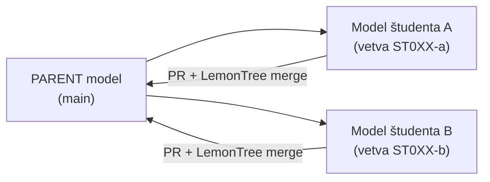

# EA model – STHDF 2026-2027 (decentralizované modelovanie)

Minimalistický **rodičovský (parent) model** v Enterprise Architect (`.qea`) na výuku
decentralizovaného modelovania s Gitom a LemonTree. Nie je to model fakulty — slúži na
precvičenie princípov: **klon → vlastná vetva → zmena → Pull Request → merge**.

*EN: A minimal **parent model** (Enterprise Architect `.qea`) for teaching decentralized
modeling with Git and LemonTree: clone → own branch → change → pull request → merge.*

## Princíp



**Parent** je spoločný predok všetkých odvodených modelov. LemonTree ho potrebuje pri
trojcestnom merge (*parent / ours / theirs*), aby vedel, kto čo zmenil.

## Štruktúra

```
model/        # tu je parent model (sthdf_parent.qea)
.github/      # šablóna Pull Requestu
CONTRIBUTING.md
```

## Rýchly štart

```bash
git clone <URL-tohto-repozitara> ea-model
cd ea-model
git switch -c ST0XX-nazov-balika
# otvor model/sthdf_parent.qea v EA, zmeň svoj balík, ulož a zavri EA
git add model/sthdf_parent.qea
git commit -m "ST0XX: popis zmeny"
git push -u origin ST0XX-nazov-balika
# potom otvor Pull Request na GitHube
```

> ⚠️ Model je binárny súbor. Konflikty sa riešia **lokálne v LemonTree**, nie v GitHub UI.

## Dokumentácia

Podrobný návod (od stiahnutia `.qea` po merge, SK aj EN) je v KNIFE
[K000002 – Git workflow pre EA modely](https://knifes.systemthinking.sk/).
